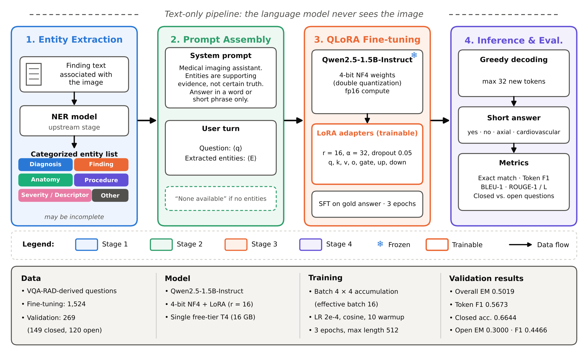
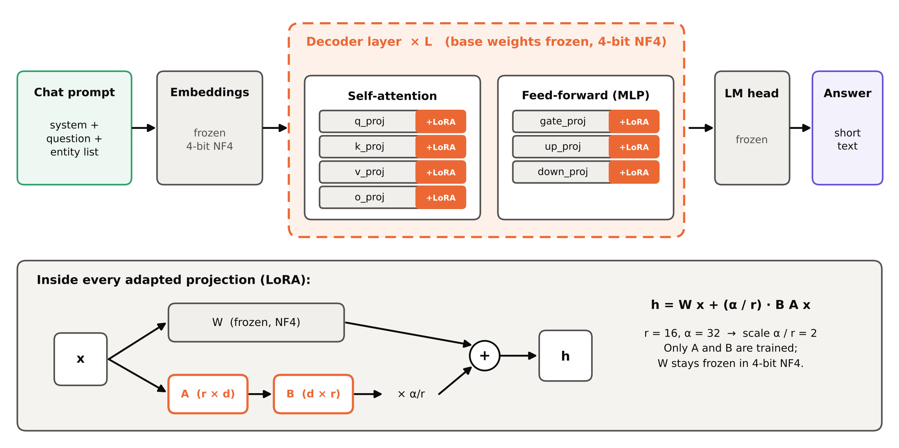
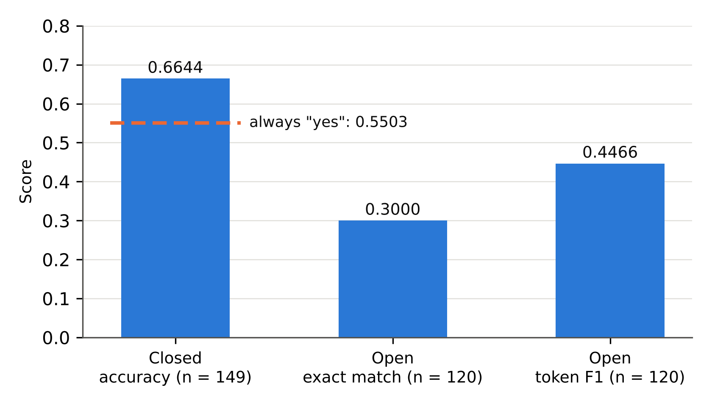
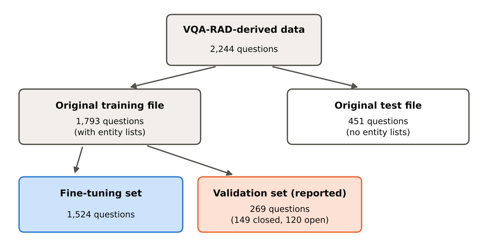
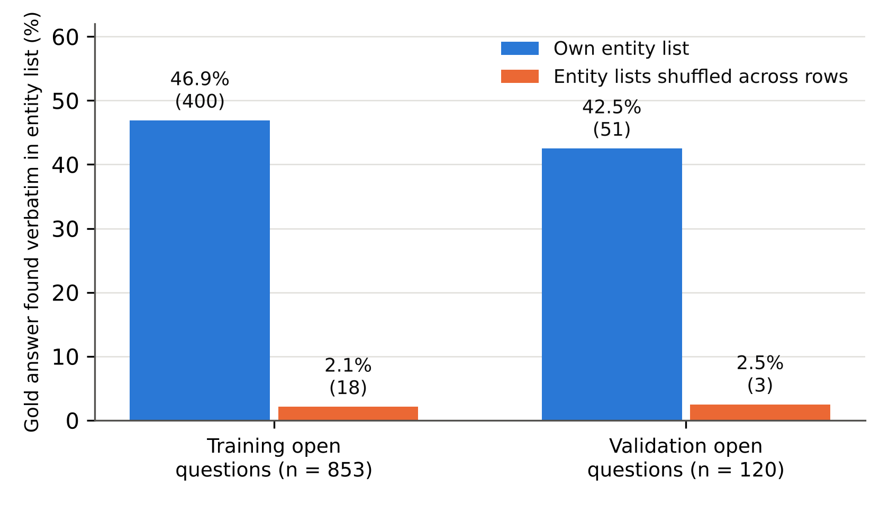

 Entity-Grounded Question Answering for Radiology VQA

A small language model (**Qwen2.5-1.5B-Instruct**, fine-tuned with **4-bit QLoRA** on a single free Colab T4 GPU) answers radiology questions **from text alone**: the question plus a categorized list of clinical entities extracted from the image's findings. The model never sees the image.

## Idea

Many radiology questions ("Is the lesion in the left lung?", "Which organ system is abnormal?") can be answered from the findings already written down. Instead of a large vision-language model, we split the task in two:

1. **Entity extraction (NER):** findings are turned into entities in six categories: Diagnosis, Finding, Anatomy, Procedure, Severity/Descriptor, Other.
2. **Answering:** a LoRA-tuned 1.5B model reads `Question + Extracted entities` and generates a short answer (`yes`, `no`, `axial`, `cardiovascular`, ...).

Only the LoRA adapters are trained, so the whole pipeline fits on a free-tier GPU.

## Results

Evaluated on a **269-question validation split** (149 closed yes/no, 120 open free-text), a random slice of the training file (see [Limitations](#limitations)).

| Question set | Exact match | Token F1 | n |
|---|---|---|---|
| Overall | 0.5019 | 0.5673 | 269 |
| Closed (yes/no) | 0.6644 | 0.6644 | 149 |
| Open (free-text) | 0.3000 | 0.4466 | 120 |

For reference, always answering "yes" scores 0.5503 on the closed questions.

Open-set BLEU-1 is 0.3949 and ROUGE-1 / ROUGE-L are 0.4466. Exact match is a strict lower bound for free-text answers: near-misses such as "cardiac" vs. "cardiovascular" score zero.

## Repository contents

| File | What it is |
|---|---|
| `FINAL.ipynb` | Training (QLoRA) and evaluation notebook, run on a Colab T4 |
| `prefinetuningdata-2.xlsx` | 1,793 training rows: `question`, `answer`, `Classified_Keywords` (entity list) |
| `test.xlsx` | The 269-row **validation** split used for the reported results (a subset of the rows above) |
| `Entity_Grounded_QA_Paper_clean.docx` | Full write-up of the method, results and limitations |
| `prepare_data.py` | Rebuilds `train-2.jsonl` (the 1,524 fine-tuning rows the notebook reads) |
| `figures/` | Diagrams and charts used in the paper and this README |
| `requirements.txt` | Python dependencies |

## How to reproduce

1. Open `FINAL.ipynb` in Google Colab (badge above) and select **Runtime > Change runtime type > T4 GPU**.
2. Upload `prefinetuningdata-2.xlsx`, `test.xlsx` and `prepare_data.py` to the Colab files panel.
3. Run `python prepare_data.py`. It writes `train-2.jsonl` (1,793 rows minus the 269 held out = 1,524). This is a reconstruction of the original file.
4. Run the training cell, then the evaluation cell. The adapter is saved to `./qwen2.5-1.5b-medvqa-lora` and per-question predictions to `eval_results.xlsx`.

Key settings: 4-bit NF4 with double quantization, fp16 compute; LoRA r=16, alpha=32, dropout 0.05 on all attention and MLP projections; 3 epochs; effective batch size 16; learning rate 2e-4 (cosine, 10 warmup steps); max length 512; greedy decoding, 32 new tokens.

## Limitations

We report these openly because they affect how the numbers should be read:

- **Validation, not test.** The 269 evaluated questions are a random slice of the training file, not the original 451-question test split. The original test split has not been evaluated.
- **Split by row, not by image.** 266 of the 269 validation questions share an image with fine-tuning questions, so scores may be optimistic.
- **Entity lists may leak the answer.** The gold answer appears verbatim in the entity list for 47% of open training questions and 42.5% of open validation questions (about 2% when entity lists are shuffled across rows). Entities extracted without knowledge of the answer may give lower scores.
- **Small data, one run.** 2,244 questions in total, a single training run, and no clinician review. The closed-question score has a margin of roughly ±7.5 points.
- **Planned ablations** (question-only, zero-shot, live NER on the original test split) have not been run yet.

## Data

The questions and answers come from [VQA-RAD](https://huggingface.co/datasets/flaviagiammarino/vqa-rad) (Lau et al., 2018). The entity lists in `Classified_Keywords` are derived from it. Images are not included in this repository.

## Authors

Paramita Naskar, Rishan Sen and Kushal Agarwal

## License

MIT, see [LICENSE](LICENSE). Please follow the VQA-RAD dataset's own license terms when reusing the data.

## References

- Lau et al., *A dataset of clinically generated visual questions and answers about radiology images*, Scientific Data, 2018.
- Dettmers et al., *QLoRA: Efficient finetuning of quantized LLMs*, NeurIPS 2023.
- Hu et al., *LoRA: Low-rank adaptation of large language models*, ICLR 2022.
- Qwen Team, *Qwen2.5 technical report*, 2024.
# entity-grounded-radiology-qa
